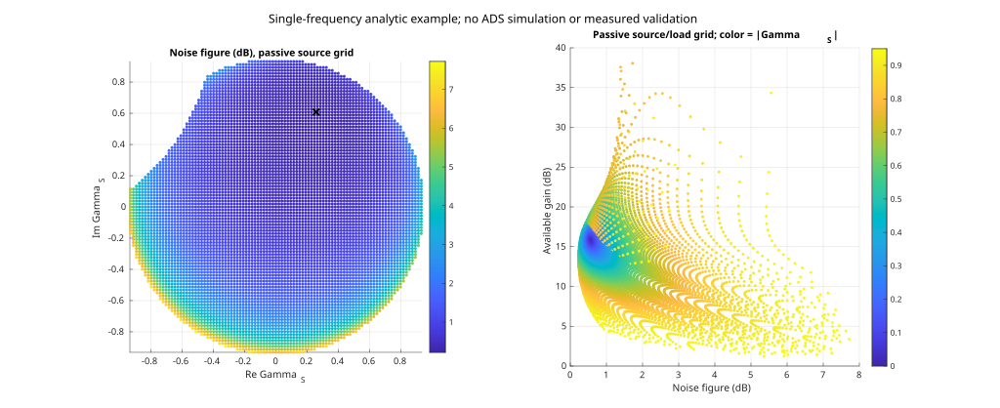

# LNA Gain–Noise Figure Design

Analytical exploration of low-noise amplifier gain, noise figure and source matching.

[](https://github.com/LhadjBENZATER/LNA-Design/actions/workflows/validate.yml)
[Paper](https://doi.org/10.1007/s00034-025-03316-1) · [Download releases](https://github.com/LhadjBENZATER/LNA-Design/releases) · [Researcher website](https://lhadjbenzater.github.io/)

The quick start uses the existing two-port helper functions with the illustrative scattering/noise parameters from the first part of `PFE.m`. It explores passive source coefficients and corresponding conjugate-matched loads at one frequency, without RF Toolbox or ADS.

## Run the example

Download and extract the latest release, or clone:

```bash
git clone https://github.com/LhadjBENZATER/LNA-Design.git
cd LNA-Design
```

Open MATLAB in this directory and run:

```matlab
result = demo_lna;
```

The example generates its inputs and needs no private files or SDR hardware.
It writes `results/demo_metrics.csv`, `results/demo_results.mat` and
`docs/preview.svg`. The SVG can be opened in a browser. For numerical output
without plotting, run `result = demo_lna(false);`.

The new example uses base MATLAB only. MATLAB R2017b or later is recommended.
CI runs the numerical checks and plotting example in **MATLAB R2024a on Linux**.
The measured elapsed time and actual runtime version appear in
[the validation log](docs/validation.txt). Runtime depends on hardware and
MATLAB release. GNU Octave compatibility has not been established.



## Model, assumptions and interpretation

The S matrix is the illustrative 2 GHz matrix written in `PFE.m`;
the supplied `Vds4V_Id40mA.s2p` identifies ATF-34143 data at Vds=4 V, Id=40 mA.
Minimum noise figure is 0.22 dB, normalized noise resistance is 4.5/50,
and the optimum source coefficient has magnitude 0.66 and phase 67°.
The demo sweeps a 101 × 101 grid inside |Gamma_S|<0.95 and keeps passive
conjugate-matched loads with positive available gain. It reports stability
parameters and plots noise figure versus available gain.

This is an analytic single-frequency illustration. It does not optimize a
finite-component network, run ADS, or reproduce measured broadband results.
No random data is used. Existing utilities retain their upstream attribution;
see [THIRD_PARTY_NOTICES.md](THIRD_PARTY_NOTICES.md).

The new example is a reproducible onboarding experiment, **not a reproduction
of the paper's full numerical campaign or hardware measurements**. The legacy
scripts remain available with their original names.

## Files and historical experiments

| Files | Purpose / prerequisites |
|---|---|
| `demo_lna.m` | Toolbox-free analytic example using the supplied RF helpers. |
| `PFE.m` | Historical matching/cascade workflow; requires RF Toolbox (`smithchart`, `rfckt.*`, `gamma2z`) and additional plotting helpers. |
| `Matching.m` | Historical RF Toolbox example. |
| `NF_Ga_evolution.m`, `Phi.m`, `Phi2.m` | Analytical exploration; review parameters and external calls before use. |
| `untitled.m`, `untitled.fig` | Historical GUIDE GUI pair; keep their names together. The root demo is the documented entry point. |
| `Vds*.s2p` / `Vds*.S2P` | Retained Touchstone device files; bias conditions are in each header. |
| `Gain shift.xlsx`, `evolution.fig`, `untitled.jpg` | Historical supporting artifacts; not required by the root demo. |

The old nonexistent S2P path in `PFE.m` and `Matching.m` is corrected to the
supplied `Vds4V_Id40mA.s2p` (matching its stated 4 V / 40 mA bias condition).
The full RF Toolbox/GUI workflows are outside the automated validation scope.
Original third-party authorship notices are retained.

See [the dependency inventory](docs/LEGACY_DEPENDENCIES.md) before running older
scripts. The new example deliberately avoids those external dependencies.

## Validation

```matlab
addpath tests
run_tests
run_validation
```

`run_validation` runs numerical checks, the demo, and the figure export. GitHub
Actions preserves CSV/MAT outputs as an `example-results` artifact and records
the preview and validation log after a successful main-branch run. The CI badge
reports execution status; it is not a certification of the paper's conclusions.

## Citation

Associated publication: **Improved Signal Quality in Compressed Spectrum Sensing: A Novel LNA Design Approach for SDR Boards**, Circuits, Systems, and Signal Processing, 45, 2109–2122, 2026.
DOI: [10.1007/s00034-025-03316-1](https://doi.org/10.1007/s00034-025-03316-1).

Use GitHub's **Cite this repository** control for citation metadata. Cite the
paper when discussing its method, and identify the software release/commit
when reporting results from this code. Paper authorship and software-maintainer
metadata are distinguished in [CITATION.cff](CITATION.cff).

## Questions and contributions

Open an issue with your MATLAB version, command, parameters and full error.
See [CONTRIBUTING.md](CONTRIBUTING.md). Research enquiries:
[Hadj Abdelkader Benzater — EMP](https://lhadjbenzater.github.io/).

## License

Author-contributed code is available under [MIT](LICENSE).
Existing RF helper notices and any applicable upstream terms also apply; see [third-party attribution](THIRD_PARTY_NOTICES.md).
